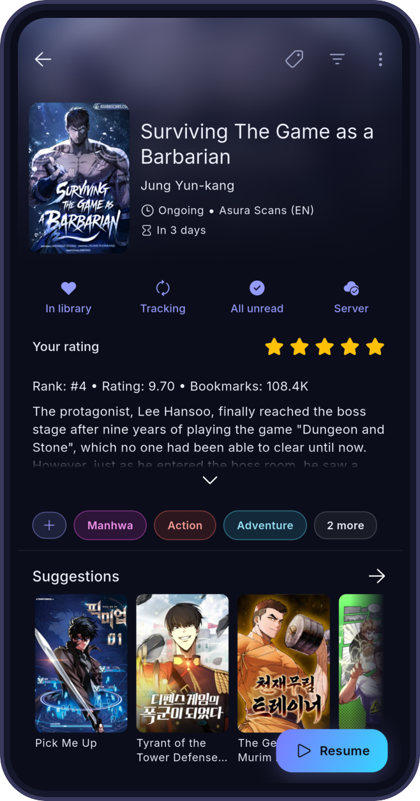
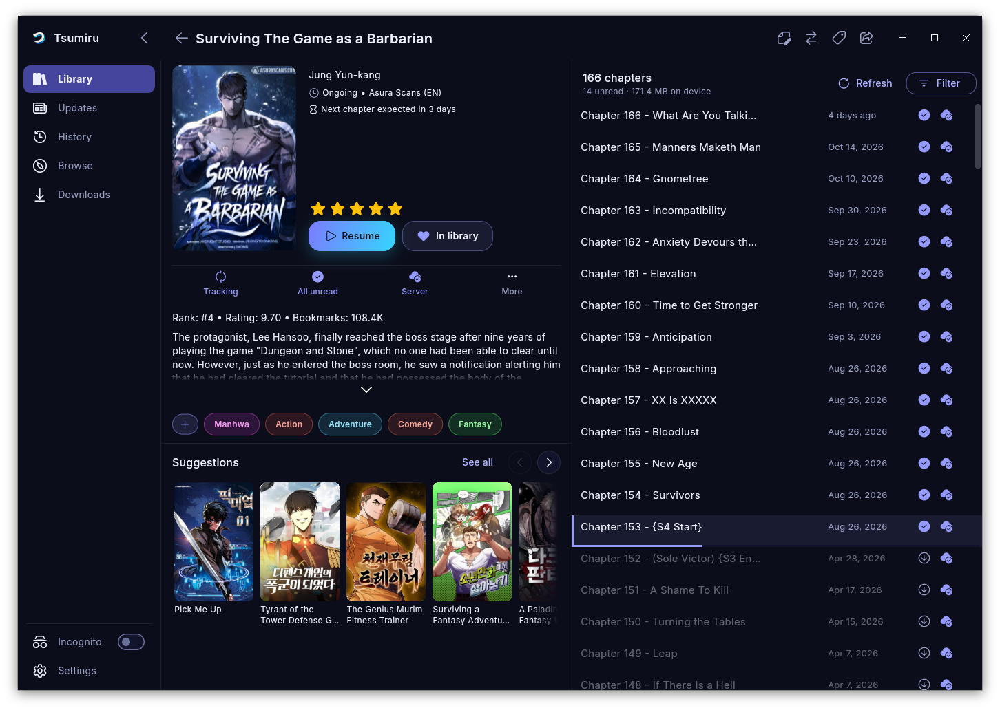

 <picture>
  <source media="(prefers-color-scheme: dark)" srcset="assets/icons/dark_icon.png">
  <source media="(prefers-color-scheme: light)" srcset="assets/icons/logo_on_light.png">
  
 </picture>

<h1 align="center">Tsumiru</h1>

A manga and webtoon reader for your Suwayomi server

> *Tsumiru* (積みる) takes the 積, "pile up", from *tsundoku* (積ん読), the Japanese habit of buying books faster than you can read them. It swaps the "read" for *miru*, "to look".

## What it is

Tsumiru is a client for [Suwayomi-Server](https://github.com/Suwayomi/Suwayomi-Server), so [you'll need a server running first](https://github.com/Suwayomi/Suwayomi-Server#downloading-and-running-the-app). Your library and reading progress are stored on the server, and Tsumiru reads them on Android, iOS, Linux, Windows, macOS or the web. Guides and the FAQ are at [tsumiru.app](https://tsumiru.app).

## Screenshots

 

## Features

- **Offline reading.** Download chapters to your device and read them without a connection. When the server is unreachable, Tsumiru opens the copies on your device.
- **Webtoon reader.** Chapters scroll into each other, and pinch-to-zoom keeps working mid-scroll.
- **Guided setup.** The first launch looks for your server on the local network and connects to it.
- **Incognito mode.** Read without adding to your history. Library categories can be hidden too.
- **Themes.** 13 built-in themes, a custom accent colour and a pure black mode for OLED screens.
- **Server login.** Supports the server's `simple_login` and `ui_login` modes and keeps credentials in the device's secure storage.
- **Library tools.** Sort by last read, latest chapter or chapter count, filter by status and bookmarks, and download chapter ranges in bulk.

## Download

Get the latest build from [Releases](https://github.com/Suwayomi/Suwayomi-Tsumiru/releases/latest). The [download page](https://tsumiru.app/download/) has install steps for each platform.

- **Android:** add this repo to [Obtainium](https://github.com/ImranR98/Obtainium) to get updates straight from GitHub Releases.
- **Linux:** the Flatpak from our own repo updates itself. An AppImage is also on Releases.
- **iOS:** the build is unsigned, so it has to be sideloaded.

You need a running Suwayomi-Server that your device can reach.

## Contributing

Pull requests are welcome. For larger changes, open an issue first so we can talk it through. Build steps are in the [contributing guide](CONTRIBUTING.md).

## Related projects

- [Suwayomi-Server](https://github.com/Suwayomi/Suwayomi-Server): the server Tsumiru connects to. It runs the sources and extensions and stores your library.
- [Suwayomi-WebUI](https://github.com/Suwayomi/Suwayomi-WebUI): the web interface bundled with the server.

## Contributors

Thank you to everyone who has contributed to Tsumiru and to Tachidesk-Sorayomi before it.

## Disclaimer

Tsumiru hosts no content and has no affiliation with any content provider. It shows what your own Suwayomi server provides.

## Credits and license

Tsumiru started as a fork of [Tachidesk-Sorayomi](https://github.com/Suwayomi/Tachidesk-Sorayomi) and depends on [Suwayomi-Server](https://github.com/Suwayomi/Suwayomi-Server). Thanks to everyone who built and maintains both.

The app typeface is [Inter](https://github.com/rsms/inter) by Rasmus Andersson, bundled (Regular, Medium, SemiBold) under the SIL Open Font License 1.1. See [assets/fonts/inter/OFL.txt](assets/fonts/inter/OFL.txt). It is also registered with the app's licence list at startup, like the Font Awesome licence.

Licensed under the [Mozilla Public License 2.0](LICENSE). Source files keep their MPL-2.0 headers.
